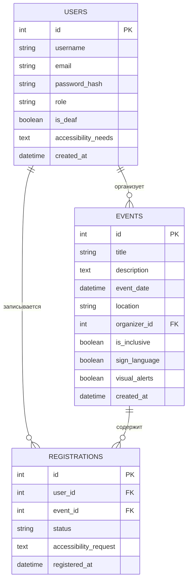

# ER-диаграмма AccessEvent

**Связи:**
- User → Event (1:N) — организатор создаёт мероприятия
- User → Registration (1:N) — пользователь делает записи
- Event → Registration (1:N) — на мероприятии много записей